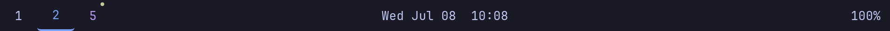
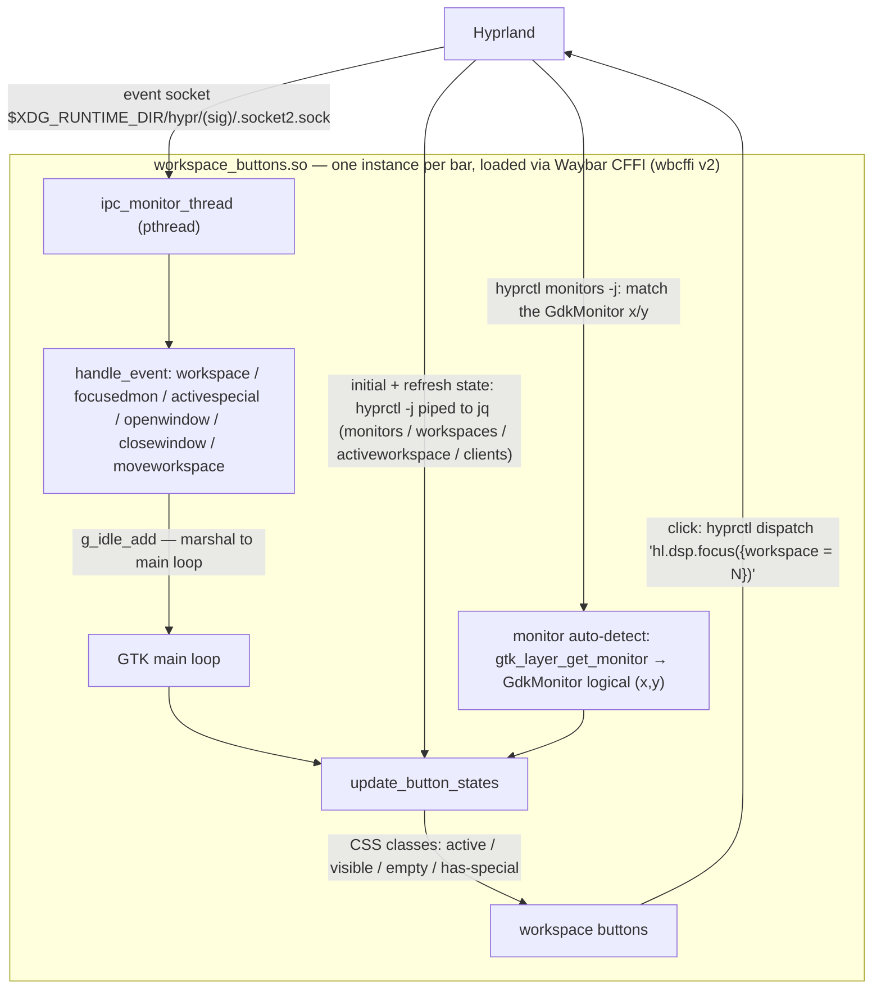

# Waybar Workspace Buttons

A fast, event-driven CFFI module for [Waybar](https://github.com/Alexays/Waybar) that displays Hyprland workspace buttons with real-time updates.

## Features



- **Per-monitor workspace filtering** - Each bar shows only its monitor's workspaces
- **Active workspace highlighting** - Different styles for focused vs unfocused monitors
- **Special workspace indicators** - Dot overlay shows workspaces with windows in `special:N`
- **Empty workspace hiding** - Configurable to show/hide empty workspaces
- **Event-driven updates** - Parses Hyprland IPC events directly for instant response
- **Click to switch** - Click any button to switch to that workspace (uses the
  Lua dispatch form, so Hyprland 0.55+ with a Lua config (`hyprland.lua`) is
  required for clicks to work)

## Why This Module?

The built-in Waybar Hyprland module spawns multiple subprocesses on every workspace event. This module:
- Connects directly to Hyprland's IPC socket
- Parses events in-process without spawning shells
- Only queries `hyprctl` when window counts change
- Results in near-instant UI updates with minimal CPU overhead

## Architecture



## Installation

### Arch Linux (pacman)

Prebuilt packages are published to the `[mason]` repo. Add to `/etc/pacman.conf`:

```ini
[mason]
# Import the signing key first: https://github.com/MasonRhodesDev/arch-repo#use-it
SigLevel = Required DatabaseRequired
Server = https://masonrhodesdev.github.io/arch-repo/x86_64
```

Then:

```bash
sudo pacman -Syu waybar-workspace-buttons
```

The module installs to `/usr/lib/waybar/workspace_buttons.so` and ships
`workspace-zones(7)`. Since 1.5.0 it replaces the retired
`hyprland-workspace-zones` and `hyprland-workspace-zones-git` plugin
packages, so pacman offers to remove whichever one is installed.

New releases land in the repo automatically — update with `pacman -Syu` like
any other package. You can also build the same package yourself from
`packaging/PKGBUILD` with `makepkg`.

### Fedora (COPR)

```bash
sudo dnf copr enable solaris765/waybar-workspace-buttons
sudo dnf install waybar-workspace-buttons
```

The module installs to `/usr/lib64/waybar/workspace_buttons.so` (note
`lib64`). Releases are submitted with `packaging/build-srpm.sh --copr` from
the release tag. Since 1.5.0 the package obsoletes the retired
`hyprland-workspace-zones` plugin package, so an upgrade removes it together
with its exact `hyprland` version pin.

#### Build targets & support cadence

The COPR project's build targets mirror
[nett00n/hyprland](https://copr.fedorainfracloud.org/coprs/nett00n/hyprland/)
(currently Fedora 43/44/45/rawhide on x86_64 + aarch64); the set is declared
in `.github/workflows/release.yml` (`copr-chroots`) and enforced on every
release.

### From source

Requires: `meson`, `ninja`, `gtk3-devel`, `gtk-layer-shell-devel`, `wayland-devel`, `wayland-protocols-devel`

```bash
meson setup build
ninja -C build
```

Then either `sudo meson install -C build` (installs to
`/usr/lib/waybar/workspace_buttons.so`) or run `./install.sh`, which copies
the module to `~/.config/waybar/cffi/workspace_buttons.so` for a per-user
install.

## Configuration

Add to your Waybar config (`~/.config/waybar/config`):

```json
{
    "modules-left": ["cffi/workspaces"],

    "cffi/workspaces": {
        "module_path": "/usr/lib/waybar/workspace_buttons.so",
        "all-outputs": false,
        "show-empty": false
    }
}
```

(Point `module_path` at `~/.config/waybar/cffi/workspace_buttons.so` instead
if you used `install.sh`.)

### Options

| Option | Type | Default | Description |
|--------|------|---------|-------------|
| `all-outputs` | bool | `false` | Show workspaces from all monitors |
| `show-empty` | bool | `false` | Show empty workspaces |
| `output` | string | auto | Override monitor name detection |

## Styling

Add to your Waybar CSS (`~/.config/waybar/style.css`):

```css
#workspaces button {
    padding: 0 8px;
    min-width: 24px;
    color: @text;
    background: transparent;
    border: none;
    border-radius: 4px;
}

#workspaces button.active {
    color: @primary;
    border-bottom: 2px solid @primary;
}

#workspaces button.visible {
    color: @secondary;
}

#workspaces button.empty {
    color: @surface2;
}

#workspaces button.has-special {
    /* Workspace has windows in special:N */
}
```

### CSS Classes

| Class | Meaning |
|-------|---------|
| `active` | Workspace is active AND monitor is focused |
| `visible` | Workspace is active but monitor is NOT focused |
| `empty` | Workspace has no windows (regular or special) |
| `has-special` | Workspace has windows in its `special:N` workspace |

## Special Workspace Integration

This module works with Hyprland's per-workspace special workspaces (`special:1` through `special:9`). When a workspace has windows in its corresponding special workspace, a colored dot indicator appears in the top-right corner of the button.

The dot color comes from `lmtt tokens --key tertiary`, or `#adc8f8` if LMTT is unavailable.

### Per-workspace special zones

Every numeric workspace can own a scratch zone: workspace `N` owns
`special:N`. It is the setup the `has-special` dot was built for.

Zones are a few lines of Lua in the Hyprland config. They need Hyprland
**0.57+** with the **Lua config** (`hyprland.lua`) and no compositor plugin.
hypr-DE ships them. For another config:

```lua
local zones = {}

local function zone_owner()
    local ws = hl.get_active_workspace()
    return ws and ws.id or nil      -- nil on a named workspace
end

function zones.toggle()
    local id = zone_owner()
    if id then hl.dispatch(hl.dsp.workspace.toggle_special(tostring(id))) end
end

function zones.move(follow)
    local id = zone_owner()
    if id then hl.dispatch(hl.dsp.window.move({ workspace = "special:" .. id, follow = follow })) end
end

hl.bind("SUPER + ALT + S",         function() zones.toggle() end)
hl.bind("SUPER + ALT + SHIFT + S", function() zones.move(true) end)
hl.bind("SUPER + CTRL + ALT + S",  function() zones.move(false) end)

hl.config({ binds = { hide_special_on_workspace_change = true } })
```

`hide_special_on_workspace_change` is what closes a zone when its workspace
is left, no matter how the switch happened. It is scoped to the target
workspace's monitor, and it also covers switching to the workspace already
underneath the special. It applies to named specials such as `special:magic`
too.

`man workspace-zones` is the full reference. hypr-DE's help window
(`hypr-de-help`, SUPER+/) explains how zones differ from the named
scratchpad.

Until 1.5.0 zones came from a compiled Hyprland plugin in this repo.
[ADR 2026-11-10](docs/decisions/2026-11-10-zones-in-lua-not-a-plugin.md)
records why it was retired.

## Hyprland Events Handled

The module listens for these events on the Hyprland IPC socket:

- `workspace>>N` - Workspace switch
- `focusedmon>>MONITOR,WS` - Monitor focus change
- `activespecial>>...` - Special workspace toggle
- `openwindow>>`, `closewindow>>`, `movewindow>>` - Window events
- `createworkspace>>`, `destroyworkspace>>` - Workspace lifecycle
- `moveworkspace>>` - Workspace moved to different monitor; re-derives this
  monitor's active workspace from `hyprctl monitors`

## License

MIT
